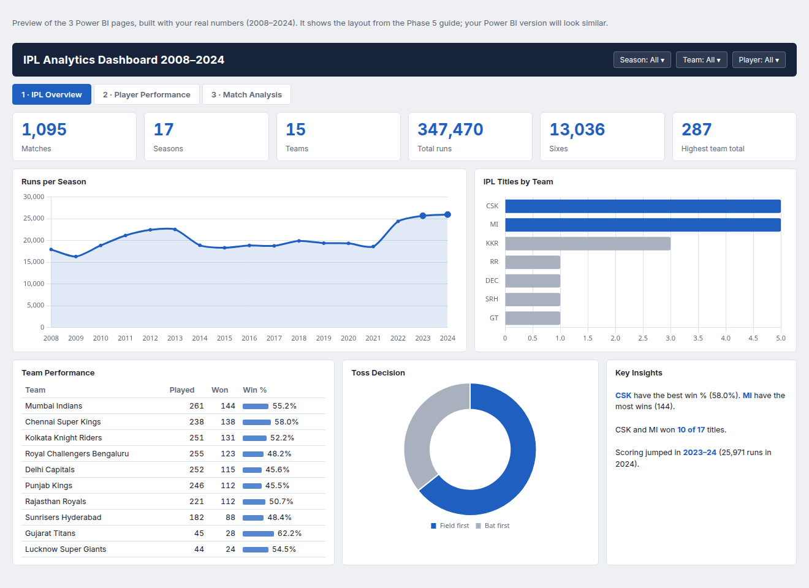
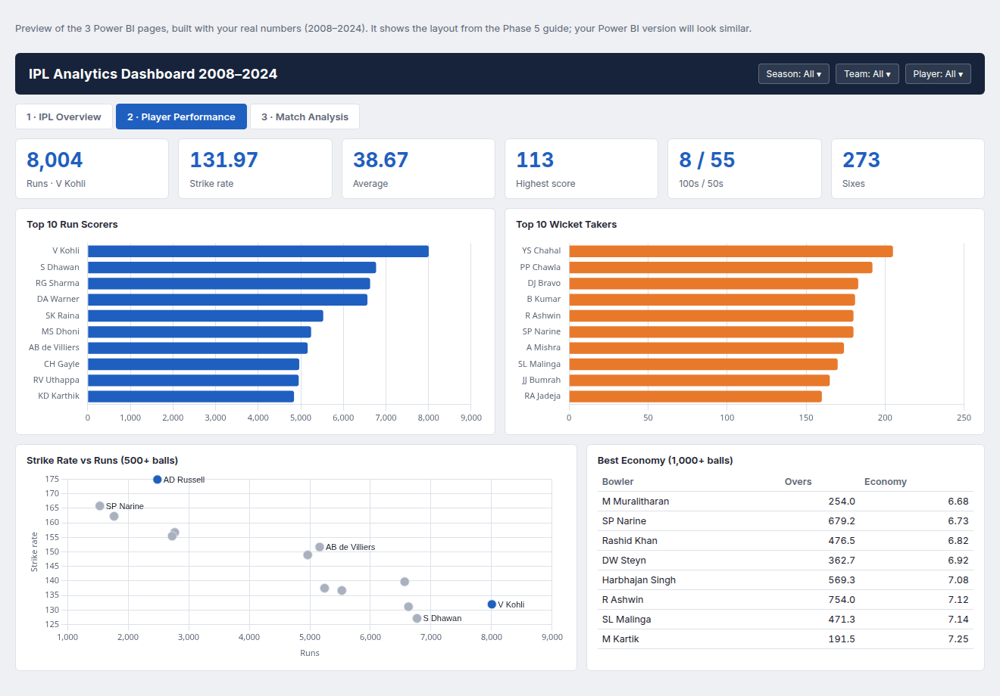
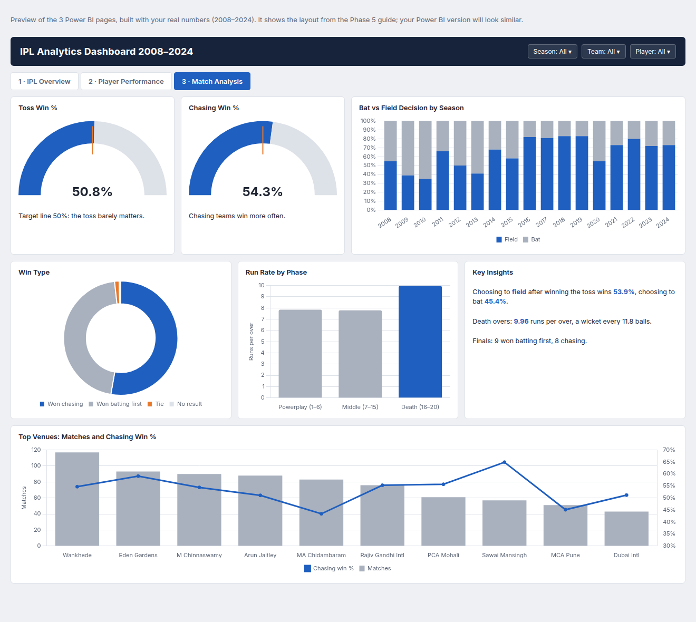

# IPL Data Analytics and Performance Dashboard

**Using Python, SQL and Power BI** — BCA Final Year Project

An analytics system that studies Indian Premier League (IPL) data from 2008 to 2024. Python cleans the data, MySQL stores and queries it, and Power BI shows it on an interactive dashboard of team, player and match performance.

---

## Dashboard Preview

> Preview of the planned layout, built with the project's real 2008–2024 numbers ([dashboard_preview.html](powerbi/dashboard_preview.html)).

**Page 1 – IPL Overview**


**Page 2 – Player Performance**


**Page 3 – Match Analysis**


---

## Tech Stack

| Layer | Tool | Purpose |
|---|---|---|
| Data source | CSV files (Kaggle) | Raw match and ball-by-ball data |
| Cleaning & EDA | Python, Pandas, NumPy, Jupyter | Fix missing values, standardise names, explore data |
| Storage & queries | MySQL 8 | Relational tables, keys, analytical SQL |
| Visualisation | Power BI Desktop | Interactive 3-page dashboard |
| Version control | Git + GitHub | Track and share the project |

## Folder Structure

```
.
├── data/
│   ├── raw/          # Put downloaded matches.csv and deliveries.csv here (not uploaded to GitHub)
│   └── cleaned/      # Cleaned CSVs created by Phase 3
├── docs/             # Phase-wise explanation documents
├── notebooks/        # Jupyter notebooks (inspection, cleaning, EDA)
├── scripts/          # Python script that loads the cleaned CSVs into MySQL
├── sql/              # MySQL scripts: create tables, load data, analysis queries
├── powerbi/          # Power BI .pbix file (Phase 5)
├── report/           # Final project report (Phase 7)
├── requirements.txt  # Python libraries
└── README.md
```

## How to Run This Project

### 1. Install the software
- **Python 3.10+**: https://www.python.org/downloads/ (on Windows, tick **"Add Python to PATH"**)
- **Git**: https://git-scm.com/downloads
- **MySQL 8 Community Server + Workbench**: https://dev.mysql.com/downloads/installer/ (Phase 4)
- **Power BI Desktop** (Windows only): Microsoft Store → "Power BI Desktop" (Phase 5)

### 2. Get the code
```bash
git clone https://github.com/<your-username>/ipl-analytics-dashboard.git
cd ipl-analytics-dashboard
```

### 3. Create a virtual environment and install the libraries
> **Linux/macOS:** type `python3` instead of `python` for the first command. On Ubuntu, run `sudo apt install python3-venv` first. After the venv is activated, `python` works everywhere.

```bash
python -m venv venv
# Windows:
venv\Scripts\activate
# macOS / Linux:
source venv/bin/activate

pip install -r requirements.txt
```

### 4. Download the dataset
Follow [data/raw/README.md](data/raw/README.md). You should end up with `data/raw/matches.csv` and `data/raw/deliveries.csv`.

### 5. Run the notebooks
```bash
jupyter notebook
```
Run these in order (open each one, then **Kernel → Restart & Run All**):
1. `notebooks/01_data_inspection.ipynb`: looks at the raw data
2. `notebooks/02_data_cleaning_eda.ipynb`: cleans the data, does EDA, and writes `data/cleaned/*.csv`

### 6. Build the MySQL database
1. In MySQL Workbench, open and run `sql/01_create_database.sql` (⚡).
2. In the terminal, run `python scripts/load_to_mysql.py` and enter your MySQL password.
3. Open `sql/03_analysis_queries.sql` and run any query with **Ctrl + Enter**.

Details: [docs/phase4_mysql.md](docs/phase4_mysql.md)

### 7. Open the Power BI dashboard (Windows only)
1. Install Power BI Desktop (Microsoft Store) and MySQL Connector/NET.
2. Open `powerbi/IPL_Dashboard.pbix` → **Home → Refresh** (enter your MySQL password when asked).

To build it yourself, follow [docs/phase5_powerbi.md](docs/phase5_powerbi.md).

**No Windows?** Run `python scripts/export_for_powerbi.py` to export the MySQL tables to one Excel workbook, then follow [docs/phase5_powerbi_web.md](docs/phase5_powerbi_web.md) to build the dashboard at app.powerbi.com. A PDF export of the dashboard is in `powerbi/`.

## Project Phases

- [x] Phase 1 – Project Introduction ([docs/phase1_introduction.md](docs/phase1_introduction.md))
- [x] Phase 2 – Dataset Collection ([docs/phase2_dataset_guide.md](docs/phase2_dataset_guide.md))
- [x] Phase 3 – Python Data Cleaning & EDA ([docs/phase3_data_cleaning.md](docs/phase3_data_cleaning.md))
- [x] Phase 4 – MySQL Database & SQL Queries ([docs/phase4_mysql.md](docs/phase4_mysql.md))
- [x] Phase 5 – Power BI Dashboard guide ([docs/phase5_powerbi.md](docs/phase5_powerbi.md)); `.pbix` to be added after building
- [x] Phase 6 – Insights ([docs/phase6_insights.md](docs/phase6_insights.md))
- [ ] Phase 7 – Project Report
- [ ] Phase 8 – Interview Preparation

## Dataset Credit
IPL Complete Dataset (2008–2024) on Kaggle, used for academic purposes only.
